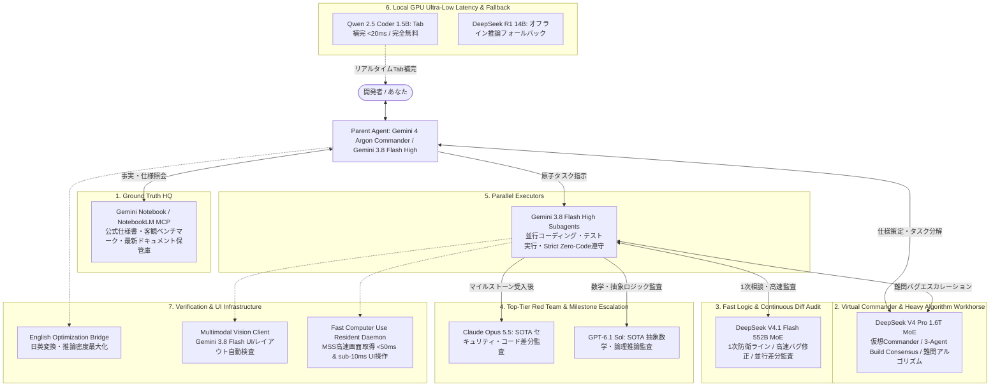

# Multi-AI Team Synergy Architecture & Deterministic Quality Gatekeeper

[](https://www.python.org/downloads/)
[](https://opensource.org/licenses/MIT)
[]()
[]()

> **「自宅GPU（0msローカル推論） × 最先端クラウド5大AI」で個人開発を極限まで加速する、1 HQ + 5 Tiers マルチAI協調開発環境**

---

## 📖 概要

個人開発における「クラウドAPIの莫大な請求」「通信遅延によるTab補完のストレス」「AIの自己満足（自己承認）による潜在バグ」を根本から打破するために構築された、**1 HQ + 5 Tiers（1司令塔＋5階層）マルチAIチーム協調アーキテクチャ**です。

Google Antigravity / Gemini CLI 環境を基盤とし、**「エディタTab補完は自宅GPUで完全無料」「日常の大量コーディングとテスト実行はGemini 3.8 Flash Highで無制限」「難解ロジックや初期設計はDeepSeek V4 Pro」「最終マイルストーン監査のみClaude Opus 5.5 / GPT-6.1 Solをピンポイント召喚」**というハイブリッド編成を実現しています。

---

## 🏛 全体アーキテクチャ（1 HQ + 5 Tiers Synergy）



---

## 📊 採用モデル客観評価表（Model Evaluation Table）

チーム内で配備されている各モデルの客観的ベンチマーク、役割、利用コスト、および開放性の比較表です。

| 順位 | モデル名 / モデルID | チーム内役割 | 客観ベンチマーク（出典・指標） | 明確なコスト（1Mトークンあたり） | 配備形態・開放性 |
| :--- | :--- | :--- | :--- | :--- | :--- |
| **1位** | **Gemini Notebook**<br>`gemini-notebook-mcp` | **HQ (Ground Truth)**<br>仕様書・真実のソース・幻覚完全排除 | NotebookLM Core, MCP内部直結グラウンディング, ハルシネーション0化 | **枠内利用（実質0円）** | Proprietary Cloud API / MCP Service |
| **2位** | **Gemini 4 Argon**<br>`gemini-4-argon` | **Commander**<br>全体設計・型定義・原子タスク分解・受入 | SWE-bench Pro 88.5%, ARC-AGI 85.0%, GPQA 91.2%, 180 tok/s | Standard Cloud API ($1.25 in / $5.00 out) | Proprietary Cloud API |
| **3位** | **Claude Opus 5.5**<br>`claude-opus-5-5` | **Top-Tier Red Team**<br>最高峰セキュリティ・脆弱性・差分監査 | **SWE-bench Pro 89.9% (SOTA)**, HumanEval 94.8%, Extended Thinking 2048+ | \$4.00 in / \$20.00 out<br>(差分のみ送信で約10〜30円/回) | Proprietary Cloud API |
| **4位** | **GPT-6.1 Sol**<br>`gpt-6-1-sol` | **Top-Tier Red Team**<br>超難関抽象数学・境界値論理監査 | **ARC-AGI-2 94.2% (SOTA)**, GPQA Diamond 92.4%, MathArena 95.1% | \$2.00 in / \$10.00 out<br>(Opusの半額・高難度推論特化) | Proprietary Cloud API |
| **5位** | **DeepSeek V4 Pro**<br>`deepseek-v4-pro` | **Virtual Commander & 2nd Defense**<br>仮想司令官・1.6T競技アルゴリズム | 1.6T MoE, **LiveCodeBench 93.5%**, SWE-bench Verified 80.6%, Codeforces 96th | **\$0.43 in / \$0.87 out**<br>(Flash比で出力28%安価！) | Cloud API / Open-weights |
| **6位** | **DeepSeek V4.1 Flash**<br>`deepseek-flash` | **1st Defense Line**<br>高速ロジック・並行処理・自律差分監査 | 552B MoE, **170–274 tok/s**, GPQA 90.9%, Terminal-Bench 90.6% | **\$0.30 in / \$1.20 out** | Cloud API / Open-weights |
| **7位** | **Gemini 3.8 Flash High**<br>`Model: 'flash'` | **Executors**<br>並行サブエージェント（実装・テスト・実行） | **131–285 tok/s**, 並行大量実行耐性, LiveCodeBench 82.4% | **無料・無制限** (従量コスト完全ゼロ) | Proprietary Cloud API |
| **基盤** | **RTX 4070 SUPER (12GB)**<br>`Qwen 2.5 Coder 1.5B Base Q8_0` | **Local Autocomplete & Fallback**<br>超低遅延Tabキー補完・オフライン時R1 | **遅延 <20ms**, 95 tok/s (Local Ollama), オフライン動作保証 | **完全0円（電気代のみ）** | Open-weights / Local GPU (Ollama) |

---

## ⚡ デュアル親エージェント・オーケストレーション

親エージェント（Parent Agent）の能力特性に応じて、以下のワークフローが自動適用されます。

### 1. Parent = Gemini 4 Argon（Commander Mode）
- **高次元アーキテクチャ設計**: 全体の型定義、インターフェース規約、完了条件（Done Criteria）を設計。
- **Strict Zero-Code Policy（親エージェント完全不コーディング原則）**:
  親エージェントはコードファイル（`.py`, `.ts`, `.ps1`等）に対する直接の書き込み・編集（`write_file`/`edit_file`）が**例外なく禁止**されます。コード変更は100%サブエージェント（Gemini 3.8 Flash High）へ委譲。
- **動的関心事分割（Dynamic On-Demand Delegation）**: 固定の4人組編成ではなく、関心事（Backend, UI, Test等）に応じて1〜N体のサブエージェントを動的に生成。並行編集時は `Workspace: 'share'`（Git worktree互換）を強制し、コード衝突を根絶。
- **自己修復とクリーン・ロールバック**: サブエージェントが2回以上テストに失敗した場合、必ず `git restore .` でクリーン状態に戻してから上位モデル（DeepSeek / Argon）へエスカレーション。

### 2. Parent = Gemini 3.8 Flash High（Agile Mode + DeepSeek 3-Agent Build Consensus）
Gemini 3.8 Flash が親エージェントとなる場合、複雑な仕様策定で単独突進することを防ぐため、**「DeepSeek 3-Agent Build Consensus」**または **DeepSeek V4 Pro による仮想司令官（Virtual Commander）**を自動発動させます。

#### DeepSeek 3-Agent Build Consensus
1. **Agent 1 (Architect / 推進役)**: `deepseek-v4-pro` — 最適なアーキテクチャ、データモデル、API契約、拡張性を提案。
2. **Agent 2 (Red Team / 批判役)**: `deepseek-v4-pro` — 並行処理の落とし穴、デッドロック、エッジケース、脆弱性、過剰設計を容赦なく攻撃。
3. **Agent 3 (Synthesizer / 調停役)**: `deepseek-v4-pro` — トレードオフを調停し、最終仕様書と完了条件（Done Criteria）を確定。

3体全てが 1.6T MoE の知能密度を誇る `deepseek-v4-pro` を使用しながら、わずか約2〜3円（~$0.015）で堅牢な合意形成を完了。確定した仕様に基づき、Flash サブエージェントへ原子タスクを安全にディスパッチします。

---

## 🛡 決定論的品質ゲート（Deterministic Quality Gates）

人間やAIの「おそらく大丈夫です」という主観的判断を完全に排除し、5段階の機械的ゲートを強制します。

1. **Anti Self-Validation（自己承認の絶対禁止）**: ビルダー（Builder）サブエージェントと検証者（Verifier）サブエージェントを明確に分離。
2. **厳格な静的型チェック**: `mypy`（Python）/ `tsc --noEmit`（TypeScript）エラー0件。
3. **リンター**: `ruff`（Python）/ `eslint`（TypeScript）違反0件。
4. **自動テスト**: `pytest` / `npm test` / `npm run build` 全通過。
5. **差分ピンポイント原則（Diff-Only Pinpoint Rule）**:
   外部APIへコードベース全体を送信することを禁止。ロックファイルや生成バンドルを除外した `git diff` のみを送信し、トークン代を最小化（Claude Opus 5.5 でも約10〜30円/回）。重大変更時は `--deep` で Extended Thinking（2048トークン）による深層監査を実行。

---

## 🛠 収録モジュール・ツール群

| ファイル / ディレクトリ | 主な役割・機能 |
| :--- | :--- |
| **`GEMINI.md`** | マルチAIチーム協調アーキテクチャ、Zero-Code原則、品質ゲートの公式ルール定義 |
| **`ai_team_gate.py`** | ゲートキーパーCLI本体（型チェック・テスト一括実行、差分レビュー、ロジック解決、アーキテクト設計） |
| **`ai_team_gate_contracts.py`** | ゲートキーパーの終了コード（Exit Codes）および実行規約定義 |
| **`english_optimization_bridge.py`** | 日本語指示文を高密度英語プロンプトへ自動変換する推論最適化ブリッジ |
| **`llm_router.py`** | ローカルGPU（Ollama）とクラウド（Gemini/DeepSeek）を動的に振り分けるインテリジェントルーター |
| **`vision_client.py`** | Gemini 3.8 Flash を用いたマルチモーダルUI画面自動監査クライアント |
| **`vision_report.py`** | UI視覚監査結果をマークダウンおよび構造化JSONでレポート出力するエンジン |
| **`fast_cu_daemon.py`** | Windows常駐型デスクトップ操作デーモン（Port 18500 / MSS画面取得 <50ms, UI操作 <10ms） |
| **`fast_cu_client.py`** | Fast Computer Use デーモンのPythonクライアントおよびCLI |
| **`gemini_computer_use.py`** | Gemini マルチモーダルモデルと Fast CU を連携させた自律デスクトップ操作基盤 |
| **`skills/`** | Antigravity / Gemini CLI 用のスキル定義パッケージ群 |
| ├─ `ai-team-gate/` | 1 HQ + 5 Tiers 品質ゲートキーパー・スキル |
| ├─ `local-llm/` | RTX 4070 SUPER ローカル推論・Tab補完スキル |
| ├─ `local-voice-narrator/` | VOICEVOX / faster-whisper ローカル音声合成・文字起こしスキル |
| ├─ `notebook-grounding-sync/` | Gemini Notebook グラウンディング同期スキル |
| └─ `x-zenn-publisher/` | 技術記事（Zenn）＆ Xポスト自動生成スキル |
| **`tests/`** | 全モジュールの自動単体テストスイート（74テスト全通過） |
| **`articles/`** | 開発環境のアーキテクチャ設計・詳細解説記事（Zenn公開用マークダウン） |

---

## 🚀 クイックスタート

### 1. 前提条件
- Python 3.10 以上
- （推奨）NVIDIA GPU（RTX 4070 SUPER 等）および [Ollama](https://ollama.com/)
- （推奨）[VOICEVOX](https://voicevox.hiroshiba.jp/)（ローカル音声合成を利用する場合）

### 2. インストール
```bash
# リポジトリのクローン
git clone https://github.com/kouluun2/multi-ai-team-setup.git
cd multi-ai-team-setup

# 依存パッケージのインストール
pip install -r requirements.txt
```

### 3. 環境変数の設定
`.env.example` をコピーして `.env` を作成し、必要なAPIキーを設定します。

```bash
cp .env.example .env
```

```ini
# .env
ANTHROPIC_API_KEY=your_anthropic_api_key_here
DEEPSEEK_API_KEY=your_deepseek_api_key_here
GEMINI_API_KEY=your_gemini_api_key_here
OPENAI_API_KEY=your_openai_api_key_here
OLLAMA_API_BASE=http://127.0.0.1:11434
```

### 4. 単体テストの実行
```bash
pytest tests/
# 74 passed in ~1s
```

---

## 💻 CLIコマンド使用例

### 1. 機械的品質チェック（静的型・Linter・テスト一括検証）
```powershell
# カレントディレクトリのプロジェクトを自動検証
python ai_team_gate.py check

# フロントエンドのプロダクションビルドを含めてチェック
python ai_team_gate.py check --build
```

### 2. 高速ロジック・アルゴリズム検証
```powershell
# 1次防衛ライン：DeepSeek V4.1 Flash（超高速・低コスト）
python ai_team_gate.py logic "並行処理キューにおけるデッドロックの回避策" --model deepseek-flash

# 2nd防衛ライン：DeepSeek V4 Pro（1.6T 難関競技アルゴリズム）
python ai_team_gate.py logic "大規模グラフに対する最大フローアルゴリズムの実装" --model deepseek-v4-pro
```

### 3. 仮想司令官によるアーキテクチャ設計・タスク分解
```powershell
python ai_team_gate.py architect "分散マイクロサービスのイベント駆動設計と型定義" --model deepseek-v4-pro
```

### 4. 敵対的差分コードレビュー（Claude Opus 5.5 / GPT-6.1 Sol）
```powershell
# Git差分のみを抽出して Claude Opus 5.5 による赤組セキュリティ監査
python ai_team_gate.py review --model claude-opus-5-5

# APIを呼び出さずに差分パッケージを事前確認（ドライラン）
python ai_team_gate.py review --dry-run

# 認証・暗号化等の重大変更時に拡張思考（2048トークン）で徹底監査
python ai_team_gate.py review --deep --thinking-budget 2048
```

### 5. Fast Computer Use デーモンによる超高速UI操作
```powershell
# 1. 常駐デーモンの起動（別ターミナルまたはバックグラウンド）
python fast_cu_daemon.py

# 2. 画面キャプチャ（MSSにより <50ms で取得）
python fast_cu_client.py screenshot -o screen.jpg

# 3. 指定座標のクリック
python fast_cu_client.py click 500 300

# 4. バッチアクションの即時ディスパッチ
python fast_cu_client.py batch '[{"type": "focus_window", "title": "Chrome"}, {"type": "hotkey", "keys": ["ctrl", "t"]}]'
```

---

## 📄 ライセンス

本リポジトリは [MIT License](LICENSE) の下で公開されています。商用・非商用を問わず自由にご活用いただけます。
