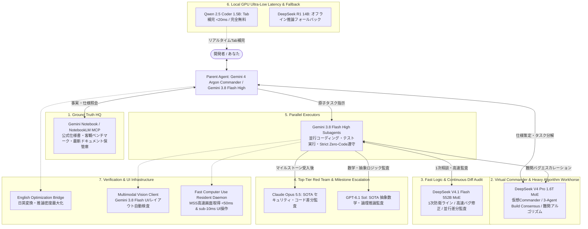
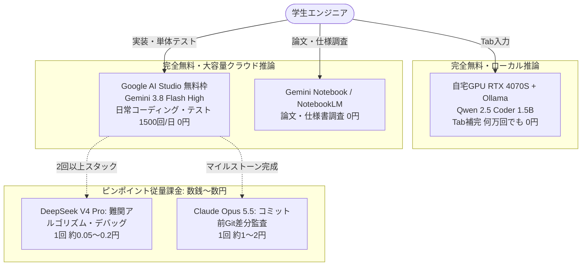

## はじめに：AIコーディングの「真のジレンマ」を打破する

生成AIを活用した個人開発やペアプログラミングにおいて、多くのエンジニアが深刻な壁に直面しています。

1. **クラウドAPIの莫大なコストとレイテンシの壁**:
   - Claude 3.7 / Opus や GPT-4o / GPT-5 等のトップ層APIを常時エディタ補完や日常的なコーディングループで回すと、月数万円から十数万円のAPI費用が一瞬で吹き飛びます。
   - クラウド越しの通信は往復で数百ms〜数秒を要し、エディタのTabキー入力補完のようなリアルタイム性（<50ms）には到底耐えられません。
2. **AI自己満足（自己承認の罠）とハルシネーション**:
   - AIにコードを書かせ、その同一AIに「テストして問題ないか確認して」と依頼すると、都合よく合格したフリをして致命的な潜在バグを見逃します（**Anti Self-Validation の原則**）。
   - ドキュメントや仕様をAIの内部知識（学習データの幻覚）に頼ると、実在しない架空のAPIを平然と呼び出して自滅します。
3. **親エージェントのコンテキスト肥大化とデバッグ泥沼化**:
   - 1つのAIエージェントに設計からコーディング、デバッグ、テストまで全て任せると、コンテキストウィンドウがエラーログで汚れ、推論精度が急激に劣化します。

これらの課題を根本から解決するために構築したのが、**「自宅GPU（RTX 4070 SUPER）の0msローカル推論」と「クラウド最先端5層マルチAIモデル」を有機的に連携させた『1 HQ + 5 Tiers Multi-AI Team Synergy Architecture』**です。

本記事では、このハイブリッド開発環境の全体設計、モデル評価表、決定論的品質ゲート（Deterministic Quality Gates）、および運用スクリプトの全貌を徹底解説します。

---

## 全体アーキテクチャ：1 HQ + 5 Tiers Multi-AI Team Synergy

本環境では、「真実のソース（Ground Truth HQ）」を頂点とし、役割と特性に応じて最も費用対効果と知能密度の高いモデルを5層（5 Tiers）に階層化して配備しています。



---

## 採用モデル客観評価表（Mandatory Model Evaluation Table）

本アーキテクチャで採用・連携しているAIモデル群の順位付けおよび客観的ベンチマーク、利用コスト、配備形態の比較表です。

| 順位 | モデル名 / モデルID | チーム内役割 | 客観ベンチマーク（出典・指標） | 明確なコスト（1Mトークンあたり） | 配備形態・開放性 |
| :--- | :--- | :--- | :--- | :--- | :--- |
| **1位** | **Gemini Notebook**<br>`gemini-notebook-mcp` | **HQ (Ground Truth)**<br>仕様書・真実のソース・幻覚完全排除 | NotebookLM Core, MCP内部直結グラウンディング, ハルシネーション0化 | **枠内利用（実質0円）** | Proprietary Cloud API / MCP Service |
| **2位** | **Gemini 4 Argon**<br>`gemini-4-argon` | **Commander**<br>全体設計・型定義・原子タスク分解・受入 | SWE-bench Pro 88.5%, ARC-AGI 85.0%, GPQA 91.2%, 180 tok/s | Standard Cloud API ($1.25 in / $5.00 out) | Proprietary Cloud API |
| **3位** | **Claude Opus 5.5**<br>`claude-opus-5-5` | **Top-Tier Red Team**<br>最高峰セキュリティ・脆弱性・差分監査 | **SWE-bench Pro 89.9% (SOTA)**, HumanEval 94.8%, Extended Thinking 2048+ | \$4.00 in / \$20.00 out<br>(差分のみ送信で約10〜30円/回) | Proprietary Cloud API |
| **4位** | **GPT-6.1 Sol**<br>`gpt-6-1-sol` | **Top-Tier Red Team**<br>超難関抽象数学・境界値論理監査 | **ARC-AGI-2 94.2% (SOTA)**, GPQA Diamond 92.4%, MathArena 95.1% | \$2.00 in / \$10.00 out<br>(Opusの半額・高難度推論特化) | Proprietary Cloud API |
| **5位** | **DeepSeek V4 Pro**<br>`deepseek-v4-pro` | **Virtual Commander & 2nd Defense**<br>仮想司令官・1.6T競技アルゴリズム | 1.6T MoE, **LiveCodeBench 93.5%**, SWE-bench Verified 80.6%, Codeforces 96th | **\$0.43 in / \$0.87 out**<br>(Flash比で出力28%安価！) | Cloud API / Open-weights |
| **6位** | **DeepSeek V4.1 Flash**<br>`deepseek-flash` | **1st Defense Line**<br>高速ロジック・並行処理・自律差分監査 | 552B MoE, **170–274 tok/s**, GPQA 90.9%, Terminal-Bench 90.6% | **\$0.30 in / \$1.20 out** | Cloud API / Open-weights |
| **7位** | **Gemini 3.8 Flash High**<br>`Model: 'flash'` | **Executors**<br>並行サブエージェント（実装・テスト・実行） | **131–285 tok/s**, 並行大量実行耐性, LiveCodeBench 82.4% | **無料・無制限** (従量コスト完全ゼロ) | Proprietary Cloud API |
| **基盤** | **RTX 4070 SUPER (12GB)**<br>`Qwen 2.5 Coder 1.5B Base Q8_0` | **Local Autocomplete & Fallback**<br>超低遅延Tabキー補完・オフライン時R1 | **遅延 <20ms**, 95 tok/s (Local Ollama), オフライン動作保証 | **完全0円（電気代のみ）** | Open-weights / Local GPU (Ollama) |

---

## デュアル親エージェント・オーケストレーション（Dual Parent Orchestration）

本システムは、司令官となる親エージェント（Parent Agent）のモデルに応じて、2つの高度なワークフローを自動で切り替えます。

### 1. Parent = Gemini 4 Argon（Commander Mode）
- **高次元アーキテクチャ設計**: 全体の型定義、インターフェース規約、完了条件（Done Criteria）を精緻に策定。
- **Strict Zero-Code Policy（親エージェント完全不コーディング原則）**:
  親エージェントはコードファイル（`.py`, `.ts`, `.ps1`等）に対する直接の書き込み・編集（`write_file`/`edit_file`）や、ターミナルでのデバッグループの実行が**例外なく100%禁止**されます。すべての実装はサブエージェント（Executors: Gemini 3.8 Flash High）へ委譲されます。
- **動的関心事分割（Dynamic On-Demand Delegation）**: 固定の4人組編成ではなく、関心事（Backend, Frontend, Test, Native等）に応じて1〜N体のサブエージェントを動的に生成。並行作業時は `Workspace: 'share'`（Git worktree互換）またはブランチ分離を強制し、コード衝突を根絶します。
- **自己修復とクリーン・ロールバック**: サブエージェントが2回以上テストに失敗した場合、必ず直前のクリーンな状態に `git restore .` でロールバックしてから、DeepSeek V4.1 Flash や DeepSeek V4 Pro へエスカレーションします。

### 2. Parent = Gemini 3.8 Flash High（Agile Mode + DeepSeek 3-Agent Build Consensus）
Gemini 3.8 Flash が親エージェントとなる場合、複雑な仕様策定で単独突進することを防ぐため、**「DeepSeek 3-Agent Build Consensus」**または **DeepSeek V4 Pro による仮想司令官（Virtual Commander）**を自動発動させます。

#### DeepSeek 3-Agent Build Consensus の仕組み
1. **Agent 1 (Architect / 推進役)**: `deepseek-v4-pro` — 最適なアーキテクチャ、データモデル、API契約、拡張性を提案。
2. **Agent 2 (Red Team / 批判役)**: `deepseek-v4-pro` — 並行処理の落とし穴、デッドロック、エッジケース、セキュリティ脆弱性、過剰設計を容赦なく攻撃。
3. **Agent 3 (Synthesizer / 調停役)**: `deepseek-v4-pro` — トレードオフを調停し、最終仕様書と完了条件（Done Criteria）を確定。

3エージェント全てが 1.6T MoE の知能密度を誇る `deepseek-v4-pro` を使用しながら、わずか約2〜3円（~$0.015）で堅牢な合意形成を完了。確定した仕様に基づき、Flash サブエージェントへ原子タスクを安全にディスパッチします。

---

## 決定論的品質ゲート（Deterministic Quality Gates）

人間やAIの「おそらく大丈夫です」という主観的判断を完全に排除し、5段階の機械的ゲートを強制します。

### 1. Anti Self-Validation（自己承認の絶対禁止）
実装を担当したビルダー（Builder）サブエージェント自身が品質検証を完了とみなすことは禁止。必ず独立した検証者（Verifier）サブエージェント、または外部監査モデルがテスト結果を精査します。

### 2. 厳格な静的型チェック & リンター
- Python: `mypy`（エラー0件）、`ruff`（規約違反0件）
- TypeScript: `tsc --noEmit`（型エラー0件）、`eslint`（違反0件）

### 3. 自動テスト完全通過
- `pytest`（単体テスト・契約テスト 100% PASS）
- `npm test` / `npm run build`（ビルドエラー0件）

### 4. 差分ピンポイント原則（Diff-Only Pinpoint Rule）
コードベース全体を外部APIに流すのは**トークン費用の無駄であり、セキュリティ的にも最悪**です。
`ai_team_gate.py review` は、Git のコミット前差分（`git diff`）のみを抽出し、ロックファイルやトランスパイル後のバンドルファイルを除外して送信します。
```bash
git diff HEAD -- ':(exclude)*.lock' ':(exclude)*.min.js' ':(exclude)dist/*'
```
これにより、Claude Opus 5.5 の最高峰レビューであっても、1回あたりわずか約10〜30円に抑えられます。認証や暗号化、並行処理等の重大変更時には `--deep` フラグにより、Claude の拡張思考（Extended Thinking: 2048トークン）を発動させて深層監査を実行します。

---

## 独自ツール群：開発効率を極限化する3大インフラ

### 1. English Optimization Bridge (`english_optimization_bridge.py`)
日本語の要件定義や指示文を、LLMが最も高い推論性能を発揮する高密度な英語プロンプトへ自動変換。タスク種別（アーキテクチャ策定、デバッグ、セキュリティ監査）に応じた最適なシステムフレームを付与し、トークン消費を抑えつつ推論精度を最大化します。

### 2. Multimodal Vision UI Audit (`vision_client.py` & `vision_report.py`)
Gemini 3.8 Flash のマルチモーダル視覚能力を活用し、UI画面のスクリーンショットからレイアウト崩れ、テキストのクリッピング・重なり、デザイン仕様との乖離を自動検出。重大度（CRITICAL / MAJOR / MINOR）付きのマークダウンレポートを生成します。

### 3. Fast Computer Use Resident Daemon (`fast_cu_daemon.py` & `fast_cu_client.py`)
Windowsセッション上で常駐する高速デスクトップ自動化デーモン（Port 18500）。
- **MSSによる爆速画面キャプチャ**: 画面取得とJPEG圧縮を 50ms 未満で完了。
- **PyAutoGUIの最適化ディスパッチ**: マウスクリック、文字入力、ホットキー送信を 10ms 未満で実行。
- **バッチアクション実行**: 一連の操作シーケンスを一括送信し、プロセス間通信のオーバーヘッドを極小化。

---

## 【特設コラム】けち大学生のための月額100円AI開発環境：課金ゼロでSOTAを飼い慣らす

### 1. サブスク課金の罠：月3,000円を払う前に知っておくべきこと
情報系の学部生や大学院生、あるいは独学でプログラミングを学ぶ学生にとって、毎月3,000円〜（$20）のChatGPT PlusやClaude Proのサブスクリプションは非常に重い固定費です。年間にして約37,000円——これは技術書10冊分、あるいは自炊生活の貴重な食費に相当します。

しかも、WebのチャットUIにお金を払っても以下の制約に苦しめられます。
- **エディタ補完に対応していない**: VS Codeでタイピングしながらリアルタイム（<20ms）にコード補完を出すには、ローカル推論か専用拡張機能が必要です。
- **雑にコードを貼るとRate Limit**: 数千行のエラーログやコードベースを貼り付けると、あっという間に「数時間利用不可」の制限を食らいます。
- **自己承認でバグを見逃す**: 同じチャット内で「このコード動く？」と聞いても、「はい、完璧です！」と嘘の太鼓判を押されて課題提出後に0点をもらうのがオチです。

### 2. 「無料枠95% ＋ 有料ピンポイント5%」の3層防衛陣形
この悩みを一発で吹き飛ばすのが、本マルチAIチームの**3層ハイブリッド節約戦略**です。



1. **Tab補完は自宅GPUで完全無料（0円）**:
   - RTX 4070 SUPER（手持ちのミドルレンジGPUやCPUでもOK）上で `qwen2.5-coder:1.5b` をローカル起動。エディタの入力補完を24時間叩き放題。
2. **日常のコーディングとテストはGemini 3.8 Flash High（0円）**:
   - Google AI StudioでAPIキーを無料取得すれば、1日あたり最大1,500リクエストが完全無料。課題や個人開発のコード作成・修正・単体テスト生成はすべてここで完結します。
3. **難関バグだけDeepSeek V4 Proへエスカレーション（約0.2円）**:
   - 競合状態やグラフ理論などの難関アルゴリズムでFlashがスタックした場合のみ、1.6T MoEのDeepSeek V4 Proへ相談。1回あたり缶コーヒーの1/700（約0.2円）です。
4. **マイルストーン完了時のみClaude Opus 5.5で差分監査（約1.5〜1.9円）**:
   - Diff-Only Pinpoint則を適用し、コミット直前の `git diff`（約500トークン）だけをClaude Opus 5.5に投げてセキュリティやエッジケースを徹底監査。

### 3. 月間コストシミュレーション：毎日使い倒しても月8円台
大学生が毎日フル稼働でプログラミング課題や研究コードを書いた場合の30日間シミュレーション結果です（`student_frugal_guide.py simulate` で実測算出可能）。

| 開発作業 | 活用基盤・モデル | 30日間の処理量 | 1回あたり費用 | 月間総額 |
| :--- | :--- | :--- | :--- | :--- |
| **VS CodeリアルタイムTab補完** | RTX 4070S (Qwen 2.5 Coder) | 6,000回 (200回/日) | **0.00円** | **0.00円** |
| **日常コード生成・テスト実行** | Gemini 3.8 Flash High | 900回 (30回/日) | **0.00円** | **0.00円** |
| **論文・公式ドキュメント調査** | Gemini Notebook / NotebookLM | 300回 (10回/日) | **0.00円** | **0.00円** |
| **難関競技アルゴリズム解決** | DeepSeek V4 Pro (1.6T MoE) | 12回 (週3回程度) | 約0.22円 | **2.58円** |
| **マイルストーン最終差分監査** | Claude Opus 5.5 (Diff-Only) | 3回 (マイルストーン毎) | 約1.92円 | **5.77円** |
| **月間総支出** | **マルチAIチーム 30日間稼働** | **7,215回** | — | **約 8.35 円** |

> 自販機の缶コーヒー（約140円）1本で、**16ヶ月以上**SOTAマルチAI環境をフル稼働させることができます。

### 4. 自動安全装置：月額100円上限ガバナー（`student_frugal_guide.py`）
「うっかり無限ループでAPIを叩いて数万円請求されたらどうしよう……」という学生の不安を完全にゼロにするため、専用の予算管理スクリプト `student_frugal_guide.py` を同梱しています。

```powershell
# 1. 無料枠とローカル環境の健全性を診断
python student_frugal_guide.py doctor

# 2. 差分ピンポイント監査のコストを見積もり
python student_frugal_guide.py calc --diff 500 --model claude-opus-5-5

# 3. 当月の予算消化状況を確認（デフォルト上限: 100円）
python student_frugal_guide.py status

# 4. ゲートキーパーで月額100円上限ガードを有効化
python ai_team_gate.py review --frugal
```

当月の累計利用額が100円に達した瞬間、有料SOTA呼び出しは物理的に安全遮断され、完全無料枠（Gemini Flash / ローカルOllama）へ自動誘導されます。学生のお財布を1円たりとも超過させません。

---

## クイックスタート & CLI使用例

本環境の中核ゲートキーパーである `ai_team_gate.py` の使用例です。

### 1. 機械的品質チェックの一括実行
```powershell
# 型チェック・リンター・テストを一括実行（失敗時は exit code 1 で停止）
python ai_team_gate.py check

# フロントエンドのプロダクションビルドを含めてチェック
python ai_team_gate.py check --build
```

### 2. 高速ロジック・並行処理バグの解決
```powershell
# 1次防衛ライン：DeepSeek V4.1 Flash（超高速・低コスト）
python ai_team_gate.py logic "並行処理キューで発生している競合状態とデッドロックの解消" --model deepseek-flash

# 2nd防衛ライン：DeepSeek V4 Pro（難関競技アルゴリズム・大規模改修）
python ai_team_gate.py logic "10万ノードに対する有向非巡回グラフ(DAG)の最短経路最適化" --model deepseek-v4-pro
```

### 3. 仮想司令官によるアーキテクチャ設計・タスク分解
```powershell
# DeepSeek V4 Pro による初期アーキテクチャ策定
python ai_team_gate.py architect "マルチモーダル画像解析パイプラインの非同期分散設計" --model deepseek-v4-pro
```

### 4. 敵対的差分コードレビュー
```powershell
# コミット前のGit差分を Claude Opus 5.5 に送信してセキュリティ監査
python ai_team_gate.py review --model claude-opus-5-5

# 差分パッケージの内容をAPI呼び出しなしで確認（ドライラン）
python ai_team_gate.py review --dry-run

# 認証・決済周りの変更を Claude の深層思考（Extended Thinking: 2048トークン）で監査
python ai_team_gate.py review --deep --thinking-budget 2048
```

---

## まとめ：個人開発者が「最強のAIエンジニアリング企業」を持つ時代

本環境の最大の特徴は、**「エディタの入力補完は自宅GPUでゼロ遅延かつ完全無料」「日常の大量コーディングとテストはGemini 3.8 Flash Highで無制限」「難解ロジックやアーキテクチャ策定はDeepSeek V4 Pro」「最終マイルストーン監査だけClaude Opus 5.5 / GPT-6.1 Solをピンポイント召喚」**という、徹底的に研ぎ澄まされたハイブリッド設計にあります。

日々のコーディングストレスは完全に解消され、月々のAPI費用もわずか数百円〜千円程度に収まります。
この「1 HQ + 5 Tiers」マルチAIチームアーキテクチャを導入し、異次元の個人開発スピードをぜひ体感してください！
